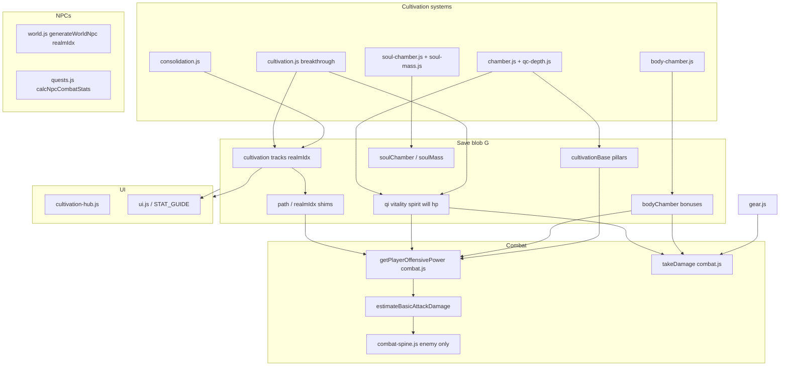

# Cultivation Capabilities & Stat Architecture Audit

| Field | Value |
|-------|-------|
| **Type** | Read-only code + design audit |
| **Date** | 2026-11-09 |
| **Scope** | Qi / Body / Soul tracks, combat, NPC parity, anatomical body, design-doc alignment |
| **Code baseline** | `main` snapshot on cloud agent VM (nine-realm names in `PATHS`, multi-track save shape) |

Evidence labels used throughout:

- **Confirmed** — traced in current `.js` save/combat paths.
- **Documented** — stated in `docs/ideas/` (may not match code).
- **Inferred** — reasonable conclusion from partial wiring; called out explicitly.

---

## A. Executive Summary

### Current architecture (one paragraph)

The live game stores almost all player capability on a single JSON blob `G` (`core.js`), with **three parallel cultivation tracks** (`G.cultivation.dantian | vessel | spirit` in `cultivation-tracks.js`) mirrored to legacy `G.path` / `G.realmIdx` via focus track. **Combat and most gates still branch on `G.path`**, not on per-track meters. Raw stats **`qi`, `vitality`, `spirit`, `will`, `hp`, `shield`, `foundation` (pillars)** remain the primary numeric inputs; **body** and **soul** chambers add **global percentage buckets** (`G.bodyChamber.bonuses`, `G.soulChamber.bonuses`), not regional capability records. **Nine-realm names** are in `data.js` `PATHS` with save migration (`migrateNineRealmLadder`); **upper vessel realms (idx 4+)** and much of **spirit idx 5+** are **progress stubs** without the designed chamber loops.

### Major strengths

1. **Multi-track cultivation state** is persisted, migrated, and used for breakthroughs, lifespan (`getEffectiveRealmTier`), and soul-embryo gate (`SOUL_EMBRYO_REALM_IDX = 3`).
2. **Body chamber** delivers a real layered grind (seven layers, external tempering salve loop, vessel realm spine for idx 0–3) with combat hooks aggregating into defense, vitality mult, poison resist, etc. (`body-chamber.js`).
3. **Foundation modernization** — Root / Flow / Stability pillars + grade UI (`foundation.js`) feed `getEffectiveFoundation()` used by Qi density, max Qi, breakthrough odds, and combat resource pools.
4. **Soul Mass + latent/active split** (`soul-mass.js`) ties spirit-track breakthrough gates and outgoing mitigation (`applySoulDamageMitigation`).
5. **Combat spine (enemy-only)** — unified hit profiles, four `systemStress` axes, structure/arm/leg cripple slots (`combat-spine.js`) — foundation for typed damage without yet touching the player.

### Most significant limitations

1. **Legacy four-stat model** still drives offensive power (`getPlayerOffensivePower`, `estimateBasicAttackDamage` in `combat.js`); breakthroughs still **grant** `vitality` / `spirit` / `will` / `maxHp` directly (`cultivation.js` ~401–415). **`stats-to-meters-rework.md` is not implemented.**
2. **Anatomical regions are presentation**, not capability storage: `hand-l` / `hand-r` share the same `boneAction: 'hands'` and the same global `actionCounts['bones:hands']` (`body-chamber.js`). No per-region persistent venom/refinement properties exist.
3. **Player combat** is a single **HP + optional shield** pool; no player `systemStress`, no regional injury. Enemy spine distinctions do not apply to the player (`combat-anatomy-damage.md` remains `idea`).
4. **NPC / world combatants** use **`realmIdx` + `ENEMIES` template scaling** (`quests.js` `calcNpcCombatStats`); they do not carry `bodyChamber`, `soulMass`, meridians, or foundation pillars.
5. **Realm advancement above body idx 3 / many spirit layers** is often **numerical** (auto progress %, consolidation, or log stubs) rather than new cultivation verbs (e.g. vessel idx 4 breakthrough log: “arrive in a later pass” in `cultivation.js` ~436–438).

### Contradictions vs audit assumptions

| Assumption | Finding |
|------------|---------|
| Stats may already be derived read-only meters | **False (Confirmed):** stats are still **written** on breakthrough, meridians, pills, physiques, tribulation, etc. |
| Anatomical body may not exist yet | **False:** substantial implementation; **but** not a regional **capability** model. |
| Nine-realm ladder may be docs-only | **Partial:** names + migration **shipped**; **gameplay depth** for new rungs is mostly **not** shipped. |
| Guards / fifth system in combat | **Partial:** player has shield + defense%; enemies have `systemStress`; **no** three-guard UI or Spirit system on player. |

---

## B. Capability Inventory

| Capability | Storage (`G` / sub-object) | Initial value | Increases / decreases | Persistence | Primary consumers | Player-facing? | Real vs abstraction | Status |
|------------|---------------------------|---------------|------------------------|-------------|-------------------|----------------|------------------------|--------|
| **Qi (current)** | `G.qi` | Path base / creation | Gather, travel, techniques, combat (linked Breath) | Persistent | Max cap, combat, breakthroughs | Yes | Meter (resource) | Implemented |
| **Max Qi** | derived + `G.maxQiBonus` | `QI_BALANCE` + realm + foundation | Breakthrough (`cultivation.js`), gear, meridians, scars | Persistent bonus field | `getMaxQi()` `core.js:333` | Yes | Cultivation capacity | Implemented |
| **Qi density** | `G.qiDensity` | Migrate from fill | Chamber gather, consolidation peaks | Persistent | `getQiDensity()`, qi-path damage | Yes | Cultivation quality | Implemented |
| **Qi purity** | `G.qiPurity` | 0 | Compress near-full dantian | Persistent | Technique costs | Yes | Refinement quality | Implemented |
| **Vitality** | `G.vitality` | `PATHS.*.base` / creation | Breakthrough, meridians, pills, physiques, chamber failures | Persistent | Body damage, max HP via `applyVitalityToMaxHp` | Yes | **Hybrid:** labeled “physical resilience” but used as generic body combat stat | Legacy abstraction |
| **Spirit** | `G.spirit` | base | Breakthrough, loot, events | Persistent | Soul damage component, flee, explore | Yes | Hybrid mental/perception | Legacy abstraction |
| **Will** | `G.will` | base | Breakthrough, events | Persistent | Soul damage, Focus pool, tribulation | Yes | Hybrid determination | Legacy abstraction |
| **HP / maxHp** | `G.hp`, `G.maxHp` | path base | Breakthrough bumps, vitality sync, gear, body % bonuses | Persistent | Combat death, pills, recuperate | Yes | Condition meter | Implemented |
| **Shield** | `G.shield`, `G.maxShield` | 0 | Regen, qi/soul path, techniques | Persistent in run | `takeDamage` barrier (`combat.js:1983`) | Yes (qi/soul) | Qi/Soul barrier — partial guard | Partial meters |
| **Foundation (effective)** | `G.cultivationBase.{root,flow,stability}`, `G.foundationCracks` | 0 | Chamber, meridians, QC grants | Persistent | Breakthrough, max Qi, density, combat pools | Grade only (no number) | Cultivation quality | Partial (single global, not per-track) |
| **Legacy `G.foundation`** | `G.foundation` | 0 | Old grants if unmigrated | Fallback in `getEffectiveFoundationFromState` | — | Hidden when migrated | Superseded by pillars | Migrating |
| **Realm (focus)** | `G.realmIdx`, `G.path` | 0, qi | Synced from focus track | Persistent | Almost all scaling | Yes | Power tier index | Implemented (shim) |
| **Per-track realm** | `G.cultivation.*.realmIdx` | 0 each | `setTrackRealmIdx` on breakthrough | Persistent | Gates, lifespan, chambers | Per chamber UI | Cultivation tier | Implemented |
| **Consolidation** | `G.cultivation[track].consolidation` | `{}` | Seal at peak | Persistent | Breakthrough gates | Yes | Peak quality | Implemented |
| **Meridians** | `G.meridians[13]` | false | `cultivation.js` open meridian | Persistent | Max Qi, foundation grants | Yes | Qi path capability | Implemented (qi-flavoured) |
| **Body layer progress** | `G.bodyChamber.layerProgress` | 0 per layer | Chamber actions, external salve | Persistent | Realm progress idx 0–3, UI fill | Yes | Cultivation progress | Implemented |
| **Body chamber bonuses** | `G.bodyChamber.bonuses` | 0 keys | `applyBodyChamberBonusDelta` per action stack | Persistent | `getBodyChamber*()` combat hooks | Indirect (action text) | **Global** % modifiers | Implemented |
| **Body action counts** | `G.bodyChamber.actionCounts['layer:id']` | 0 | Repeated refinements | Persistent | Stacks, bone **region fill** display | Partial | Global per action id, not per hand | Implemented |
| **Physique project** | `G.physique`, `G.physiqueCultivation` | null | `physique-cultivation.js` | Persistent | Stat bonuses, body hooks | Yes | Specialized build | Implemented |
| **Vessel rules** | `G.vesselRule`, cooldown | null | Blood / Unnamed rules | Persistent | Damage mult, slips (`vessel-rules.js`) | Yes | Body path specialism | Partial |
| **Soul Mass** | `G.soulMass` | zeros | Condense, birth crystallize | Persistent | Techniques `soulMassMin`, mitigation | Yes | Spirit interior weight | Implemented |
| **Soul chamber** | `G.soulChamber` | layers, prelude | Soul palace actions | Persistent | Bonuses (efficiency, dao %), spirit progress | Yes | Spirit cultivation | Partial (combat hooks TODO in file header) |
| **Soul embryo** | `G.cultivation.soulEmbryo` | false | Any track idx ≥ 3 | Persistent | Unlocks soul palace deep / mass | Yes | Cross-track watershed | Implemented |
| **Combat resource** | `G.combatResource` | init per fight | Path regen | Combat only | Attacks, techniques | Yes | Stamina/Breath/Focus | Implemented |
| **Defense %** | `G.defenseBonus` + gear + scars + body % | 0 / gear | Gear, physiques, body chamber, scars | Persistent | `takeDamage` physical line | Sometimes | Mitigation abstraction | Implemented |
| **Evasion %** | `G.evilasionBonus` + body | 0 | Same sources | Persistent | `takeDamage` | Sometimes | Mitigation | Implemented |
| **Damage mult** | `G.dmgMult` | 1 | Physiques, perks, sect | Persistent | Power formulas | Rare | Modifier | Implemented |
| **Enemy HP/dmg** | `G.enemy` instance | template + scale | Combat | Combat only | UI, AI | Yes | Abstract combatant | Implemented |
| **Enemy system stress** | `G.enemy.systemStress` | 0 | `resolveCombatHit` | Combat only | Spine breaks, bleeds | No (player) | Typed wound model | **Enemy only** |
| **Techniques** | `G.techniques[]` | learn | Loot, sect, market | Persistent | Damage, cultivation tiers | Yes | Mastery + identity | Implemented |
| **Gear** | `G.gearInstances`, equipment | creation | Forge, loot | Persistent | `gear.js` stat bundles | Yes | Equipment | Implemented |
| **Consolidation bonuses** | `G.consolidationBonuses` | zeros | Perfect seal rewards | Persistent | techniqueDmgPct, allStatsPct, etc. | Partial | Peak rewards | Implemented |
| **Tribulation scars** | `G.tribulationMarks` | — | Tribulation | Persistent | maxHp, defense, spirit downs | Yes | Lasting wounds | Implemented |
| **QC band** | `G.qcBand` | early | Redwell QC loop `qc-depth.js` | Persistent | FE breakthrough readiness | Yes | Qi condensation depth | Implemented |
| **DAO / transcendence** | `G.daoState`, perks | — | High realm content | Persistent | Combat modifiers, gates | Partial | Late-game capabilities | Partial |

---

## C. Cultivation Path Comparison

### Qi (dantian track)

| Aspect | Implementation (Confirmed) |
|--------|---------------------------|
| **Progression** | Qi chamber (`chamber.js`): gather density, expand dantian, foundation pillars, condense core; QC band for idx 0 (`qc-depth.js`); meridians (`cultivation.js`); realm seal/break via `cultivation-chamber-steps.js`. |
| **What player cultivates** | Dantian capacity & density, foundation pillars, meridian network, optional weapon intent / dao (high realm). |
| **On breakthrough** | `maxQiBonus`, +vitality/spirit/will, +maxHp, lifespan (`cultivation.js`); track idx via `setTrackRealmIdx('dantian', ...)`. |
| **Explicit capabilities** | Qi techniques, Breath pool linked to dantian (`COMBAT_QI_LINK`, `COMBAT_PATH.qi`), shield label “Qi Barrier”. |
| **Generic stat bonuses** | Still grants vitality/will/spirit on dantian breakthrough; combat power uses `getQiDensity() * 1.2 + will * 0.3`. |
| **Cross-track** | Meridians in body chamber tab for non-body path is blocked (`isBodyPathChamber`); embryo awakens from any track idx 3. |
| **vs nine-realm doc** | Names match `PATHS.qi.realms`; Celestial Avatar @ idx 4 exists as **name** — avatar **system** mostly design (`celestial-avatar.md`). |

### Body (vessel track)

| Aspect | Implementation (Confirmed) |
|--------|---------------------------|
| **Progression** | `body-chamber.js` + `BODY_VESSEL_REALM_SPINE` idx 0–3 layer requirements; external tempering salve/drill (`BODY_EXTERNAL_TEMpering_BALANCE`); vessel breakthrough `getVesselTrackBreakthroughBlockReason`. |
| **What player cultivates** | Seven global layers (skin→nerves); action stacks → `bonuses`; optional physique project; vessel rules (blood/unnamed). |
| **On breakthrough** | Extra vitality + maxHp; does **not** reset layers (carry-over); idx 4+ progress stubbed at ~80–100% (`getBodyVesselRealmProgressPct` idx > 3). |
| **Explicit capabilities** | Fortify (no shield), stamina pool, body-tagged technique mult (`applyBodyChamberPhysicalDmg`), Rule of Blood / Unnamed flows. |
| **Generic stat bonuses** | Chamber actions → `%` buckets capped in `BODY_CHAMBER_BONUS_CAPS`; effective vitality = `G.vitality * vitalityPct mult`. |
| **Cross-track** | Body chamber Qi efficiency hooks; meridians hidden on body path. |
| **vs design** | `body-stat-layers-additive.md` (**designed**) — **per-region additive terms not in code**; only global layers + visualization regions. |

### Soul (spirit track)

| Aspect | Implementation (Confirmed) |
|--------|---------------------------|
| **Progression** | Prelude @ idx 0 (`getSpiritPreludeProgressPct`); soul palace layers (`soul-chamber.js`, `SOUL_CHAMBER_LAYER_ORDER` in `data.js`); Soul Mass condense; consolidation markers for spirit track. |
| **What player cultivates** | Prelude %, chamber layers, soul mass / maturity tiers, latent mass pre-embryo. |
| **On breakthrough** | spirit/will/maxHp grants; `grantSoulApexProgress` on spirit break; embryo/mass gates at idx 3. |
| **Explicit capabilities** | Spirit damage techniques, `applySoulDamageMitigation`, Soul Shield, intimidate; technique `spiritDamage` / `soulMassMin` gates in data pool. |
| **Generic stat bonuses** | Soul chamber `%` efficiency/fear/dao bonuses; combat still uses `(will + spirit) / 2` for basics. |
| **Cross-track** | Embryo from **any** track fourth realm (owner doc tension: spirit doc prefers spirit-only birth — **still any-track in code**). |
| **vs design** | `spirit-path-full-design.md` + `stats-to-meters-rework.md` — **partial** ship; soul chamber file notes Phase 2 combat hooks open. |

---

## D. Stat Dependency Map

### Key chains (file / function)

| Flow | Chain |
|------|--------|
| Max HP | `G.maxHp` + breakthrough → `applyVitalityToMaxHp` (`core.js:424`) → `getEffectiveMaxHp` (`gear.js:423`) ← body `maxHpPct` / `flatHp` |
| Qi power | `getMaxQi`, `getQiDensity` (`core.js:333–354`) ← `getEffectiveFoundation()`, realmIdx, meridians |
| Body defense | `takeDamage` → `getBodyChamberDefensePct` (`body-chamber.js:2200`) ← summed `physicalDefensePct` + `resiliencePct` |
| Breakthrough | `attemptBreakthrough` track-aware (`cultivation.js`) → `setTrackRealmIdx` (`cultivation-tracks.js:269`) → `tryAwakenSoulEmbryo` |
| Save integrity | `prepareGameStateForSave` / `repairCultivationRealmSync` (`cultivation-tracks.js:190–208`) |
| NPC fight | `generateWorldNpc` (`world.js:1309`) → `calcNpcCombatStats` (`quests.js:166`) → `buildEnemyFromDef` (`combat.js:528`) |
| Technique hit | `calcCombatTechniqueDamage` → `buildAttackProfileFromTechnique` (`combat-spine.js:615`) → `applyResolvedHitToEnemy` (enemy HP + stress) |
| Player hit | `resolveEnemyStrike` → `takeDamage` (`combat.js:1919`) — **no** `systemStress` on player |

---

## E. Regional Specialisation Assessment (Venom-Refined Right Hand)

| # | Question | Answer | Evidence |
|---|----------|--------|----------|
| 1 | Can the model represent left/right hand difference? | **No** | `hand-l` / `hand-r` differ only in SVG region; both use `boneAction: 'hands'` and `BODY_ACTION_TO_REGIONS['bones:hands']` → both hands (`body-chamber.js:96–97, 260`). |
| 2 | Persistent independent venom property on right hand? | **No** | State is `layerProgress` (global) + `actionCounts` keyed `layer:actionId` + global `bonuses`. No `regionProperties` map. |
| 3 | Combat knows which hand struck? | **No** | Basic attack has no limb parameter (`calcBasicAttackDamage`, `buildAttackProfileFromBasic` use `G.path` only). |
| 4 | Venom only when relevant region used? | **No** | Poison resist is character-wide `poisonResistPct` (`getBodyChamberPoisonResistPct`); outgoing poison on player basics not modeled. Enemy poison via affix `applyPlayer.poisonTurns` (`data.js` ENEMY_AFFIXES). |
| 5 | Hand injury affects capabilities? | **No (player)** | Player has no regional injury. Enemy arm structure slot reduces reach ATB (`combat-spine.js` structure breaks) — **enemy only**. |
| 6 | Existing systems to reuse? | **Partial** | (a) Body action stack pattern + bonus keys; (b) technique `element` / tags; (c) enemy structure slots as template for regional debuffs; (d) vessel rules as precedent for path-specific passives; (e) `BODY_SILHOUETTE_REGIONS` for UI. |
| 7 | Missing capabilities? | **Regional state**, **attack origin / weapon region**, **outgoing effect bindings**, **player wound slots**, **cultivation methods targeting one region**, **NPC parity fields**. |

**Conclusion (Confirmed):** The venom-hand testcase **fails** on differentiation, storage, combat attribution, and injury — unless rewritten as **global** poison resist + a **venom-themed body action** (e.g. stacks on global `poisonResistPct` / custom technique), which does **not** satisfy asymmetric hands.

---

## F. Legacy Stat Assessment

| Stat / meter | Classification | Notes |
|--------------|------------------|-------|
| **Qi (current/max)** | Meaningful meter + derived max | Already functions as cultivation fuel; linked to Breath in combat. |
| **Qi density / purity** | Meaningful cultivated quality | Dense design alignment; should remain primary qi combat input post-rework. |
| **Vitality** | Misleading composite | Player-facing “physical resilience” but also **primary body offensive scalar** and max HP driver; conflates durable flesh with strike power. |
| **Spirit** | Hybrid | Explore/dao + soul combat average; not same as Soul Mass. |
| **Will** | Hybrid | Tribulation + soul combat + Focus sizing; overlaps spirit sea / maturity in design docs. |
| **HP** | Condition meter | Appropriate abstraction until regional wounds ship. |
| **Shield** | Partial **Qi/Soul guard** | Not shown for body path; not typed vs flesh. |
| **Defense % (`defenseBonus`)** | Derived mitigation | Useful; does not distinguish qi ward vs bronze skin. |
| **Foundation grade** | Meaningful quality | Pillars are right direction; still **one** foundation for all tracks (per-track **designed**, not shipped). |
| **realmIdx (focus)** | Useful index + misleading when dual-track | `getEffectiveRealmTier` uses max across tracks for some gates; combat uses focus path. |
| **Body chamber % keys** | Useful derived bonuses | Real grind output; **not** capabilities themselves — capped small % (`BODY_CHAMBER_BONUS_CAPS`). |
| **Consolidation `allStatsPct`** | Generic multiplier | Works against capability clarity. |
| **Strength (RPG)** | **Absent** | No `G.strength`; NPC `strengthRealm` is dialogue/power label only (`npc.js`). |

**Stat-to-meter migration status:** **Designed but not implemented** (`stats-to-meters-rework.md`). No derived read-only facade; Vitality/Spirit/Will still directly incremented.

---

## G. Cultivation Realm Depth Assessment

Indices `0–8` per `PATHS` (`data.js:8–83`). Lifespan table length 9 (`LIFESPAN_BY_REALM`, `data.js:3749`).

| Idx | Qi realm | Mechanical distinction vs idx−1 (Confirmed) | Mostly numerical? |
|-----|----------|---------------------------------------------|-------------------|
| 0 | Qi Condensation | QC band gather stages, no expand dantian (`chamber.js`); Redwell tutorials | **No** — QC loop is distinct |
| 1 | Foundation Establishment | Expand dantian, meridians, tribulation after QC cross | Mixed |
| 2 | Core Formation | Condense core gate, higher density caps | Mixed |
| 3 | Nascent Soul | Consolidation peaks; **soul embryo** any-track | Mixed |
| 4 | Celestial Avatar | Name + lifespan jump; **avatar combat system not in audit scope as shipped** | **Mostly numerical** + gates |
| 5 | Void Refinement | Dao fragments seeking index shift (`DAO_SEEKING_REALM_IDX = 6` still named VR at 5) | Mixed (dao content) |
| 6 | Dao Seeking | `DAO_SEEKING_REALM_IDX` content hooks | Design-heavy, partial code |
| 7 | Dao Manifestation | Law / manifestation docs | Partial |
| 8 | Immortal Ascension | Peak mortal | Numerical capstone |

| Idx | Body realm | Mechanical distinction | Mostly numerical? |
|-----|------------|------------------------|-------------------|
| 0 | External Tempering | Skin/flesh only; salve/drill loop | **No** |
| 1 | Inner Tempering | Spine layers flesh+bones; unlocks bone actions | **No** |
| 2 | Essence Pearl | Organs+blood spine | **No** |
| 3 | Nascent Physique | Nerves once-refine; consolidation | **No** |
| 4–8 | PT → Saintly Flesh | `getBodyVesselRealmProgressPct`: idx>3 uses consolidation/peak boost stub | **Yes** — log admits later pass (`cultivation.js:436–438`) |

| Idx | Soul realm | Mechanical distinction | Mostly numerical? |
|-----|------------|------------------------|-------------------|
| 0 | Sea Opening | Prelude % gate 40% | **No** |
| 1–2 | Sea Stilling / Soul Seed | Chamber layers (data-defined) | Partial |
| 3 | Soul Birth | Soul Mass hard min / latent cap gates | **No** |
| 4+ | Upper spirit names | Layer order mapped by `getSoulRealmLayerForSpiritIdx` | Increasingly **stub/numerical** without branch dao hooks in combat |

**Nine-realm ladder doc vs code:** Names for all nine tiers in `PATHS` (**Implemented**). `mortalLadderVersion` migration (**Implemented**). Dao Seeking idx in code = 6 (`data.js:1650`) matches doc. **Discrepancy:** spirit **embryo on any track** vs design preference for spirit-track soul birth (**Documented** tension). **Legacy `G.realmIdx`** still used in ~hundreds of sites alongside per-track idx.

---

## H. Recommended Migration Strategy

Staged, reusing existing systems — aligned with `stats-to-meters-rework.md` and `body-stat-layers-additive.md` without big-bang rip-out.

### Phase 1 — Data model (low risk, prerequisite for clarity)

1. **Per-track foundation** — extend `G.cultivation[track]` with `foundation` or pillar subset; migrate `getEffectiveFoundationFromState(g, track)`; keep global grade as `max()` or focus-only until design decides (`stats-to-meters-rework.md` open questions).
2. **Stat facade (read-only)** — derive `vitality` / `spirit` / `will` from meters (`vessel terms`, `soulMass`, `spirit sea depth`) for legacy readers; **stop direct writes** on breakthrough (replace with meter grants). Independent deliverable if combat still uses old formulas short-term.
3. **Regional capability schema (optional v0)** — add `G.bodyChamber.regions[regionId]` with `{ layers: {}, tags: [], injuries: [] }` without combat consumers yet — enables venom-hand design tests.

**Prerequisites:** save migration helpers pattern (`cultivation-tracks.js` migrations). **No combat change required** for facade-only.

### Phase 2 — Combat integration

1. **Enemy guards UI** — expose flesh/qi-barrier/soul-guard derived from existing enemy fields + templates (`stats-to-meters` step 3); wire before player guards.
2. **Technique-first attack nature** — extend `buildAttackProfileFromTechnique` to prefer technique tags over `G.path` (`combat-spine.js:615–628`); basic attack from equipped weapon + stance.
3. **Player system stress (optional slice)** — mirror enemy `systemStress` on `G` for tribulation/elite fights first; keep HP for casual fights.
4. **Regional attacks** — only after Phase 1 region schema + technique `originRegion` metadata.

**Depends on:** Phase 1 facade optional; guard derivation needs design numbers.

### Phase 3 — Cultivation progression

1. **Body idx 4+ chamber loops** — replace progress stub (`getBodyVesselRealmProgressPct` idx>3) with real layers per `body-path-refining-rewrite.md`.
2. **Per-region additive terms** — implement `body-stat-layers-additive.md` as extensions to `applyBodyChamberBonusDelta` or parallel `regionTerms` contributing to strike formulas.
3. **Spirit track soul-birth-only embryo** — design decision + migration for saves that awakened via dantian/vessel.
4. **Venom / method refinements** — use region schema + tagged techniques, not new global stats.

**Depends on:** Phase 1 region model for asymmetric refinements.

### Phase 4 — Player-facing UI

1. Show guards, system stress, regional overlays when mechanics exist (avoid premature UI).
2. Replace misleading vitality tooltip with vessel/Soul Mass language when facade lands (`STAT_GUIDE`, `data.js:2051`).
3. Body silhouette tooltips already show regional **visual** progress — extend to real stored properties when present.

**Depends on:** Phases 2–3 for meaningful display.

### Phase 5 — Save compatibility

1. Version bump + one-time derive meters from legacy stats (`stats-to-meters` step 1).
2. Nine-realm already at version 9 — next bump for facade/regions.
3. NPC parity: **separate** issue — optional `worldNpcs[].combatProfile` lite (realm + template guards) without full `G` clone.

### Independent vs coupled

| Deliverable | Can ship alone? |
|-------------|-----------------|
| Per-track foundation numbers | Yes |
| Stat facade (derived stats) | Yes |
| Enemy guard UI | Yes (with formula design) |
| Technique-tagged attack nature | Yes (improves dual cultivator without removing stats) |
| Body upper-realm loops | Yes (body track only) |
| Regional venom hand | Needs region schema + combat attribution |
| Full player anatomy damage | Needs player stress + UI + healing rules |

---

## I. Open Design Questions

(require owner/game-design input — not settled in this audit)

1. **Focus track vs combat identity** — Should combat use highest track, mastered technique school, or explicit stance? (`stats-to-meters-rework.md`)
2. **Soul embryo gate** — Any-track fourth realm (code) vs spirit-track-only Soul Birth (docs).
3. **Foundation per track display** — Single grade vs three grades on stats panel.
4. **Body organ role** — Regulators only vs future strike contributors (`body-stat-layers-additive.md`).
5. **HP vs regional injury** — Full sim, tagged debuffs only, or hybrid (`combat-anatomy-damage.md` parked).
6. **NPC cultivation parity depth** — Full `bodyChamber` on rivals vs narrative `realmIdx` + affixes (`world-cultivation-parity.md` if exists).
7. **Vitality retirement** — Exact mapping to vessel meter and whether strike power splits from durability.
8. **Guard numbers** — How flesh/qi/soul guards derive from chamber bonuses vs realm idx.
9. **Idx 4–8 body verbs** — Priority order for Physique Transformation vs runeforging loops.
10. **Lifespan on breakthrough** — Weight per-track vs `getEffectiveRealmTier` only.

---

## Design Documentation Status

| Document | Status vs code |
|----------|----------------|
| `nine-realm-ladder.md` | **Partially implemented** — names, indices, migration; upper gameplay fat slice not shipped |
| `cultivation-realm-depth-pass.md` | **Designed / idea** — not a code milestone |
| `stats-to-meters-rework.md` | **Designed, not implemented** — enemy stress partial only |
| `body-stat-layers-additive.md` | **Designed, not implemented** — global layers only |
| `body-external-tempering-depth.md` | **Partially implemented** — baseline salve loop in `BODY_EXTERNAL_TEMpering_BALANCE` |
| `combat-anatomy-damage.md` | **Idea** — enemy-only structure slots exist; player anatomy damage absent |
| `combat-damage-depth.md` | **Partially implemented** — four systems on enemy via spine |
| `spirit-path-full-design.md` | **Partially implemented** — mass/chamber; branches mostly design |
| `body-path-refining-rewrite.md` | **Partially implemented** — vessel 0–3 shipped |

---

## Appendix: Success Criteria Check

**What can a cultivator currently develop?**

- **Qi:** dantian capacity/density/purity, foundation pillars, meridians, techniques, intent/dao (high realm).
- **Body:** seven layer grinds, external tempering, physique projects, vessel rules, global combat % bonuses.
- **Soul:** prelude, palace layers, soul mass/maturity, spirit techniques, embryo/mass gates.

**How is development represented?**

- Mostly **global numbers** (`vitality`, etc.), **layer progress %**, **stack counts**, and **percentage bonus bags** — not per-region cultivated properties.

**What must change for capabilities to emerge naturally from cultivation?**

- Derive or replace legacy stats from track meters; add **typed guards** and **technique-driven** combat; introduce **regional (or seat-based) state** for body specialization; extend **realm idx 4+** from stubs to verbs; bring **NPCs** up to a lighter parity profile.

---

*End of audit. No gameplay files were modified as part of this investigation.*
