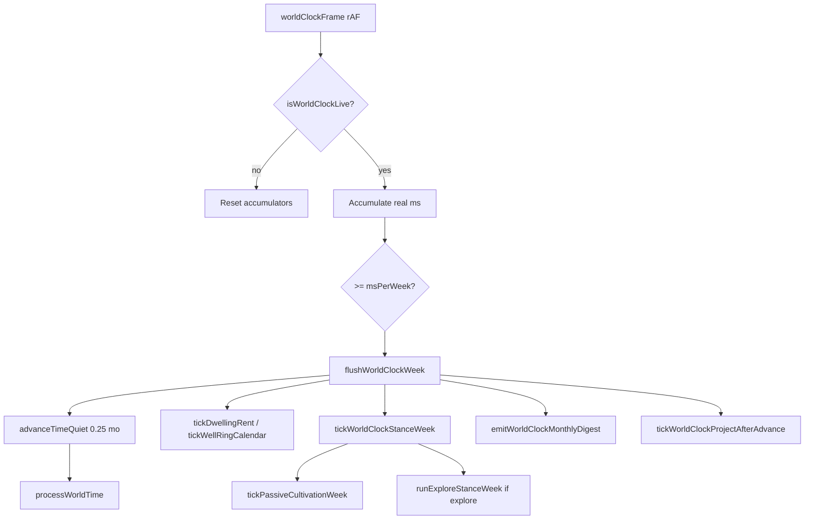

# Time, pacing & cultivation architecture

| Field | Value |
|-------|-------|
| **Status** | `designed` |
| **Blocked on** | Owner review of this doc; then GitHub Issue for first implementable slice |
| **Issue** | none yet |
| **Chat / PR** | Cloud agent architecture review (Nov 2026) |
| **Updated** | 2026-11-01 |

## Intent

Establish **one authoritative world timeline** (`G.ageMonths`) where active play, ordinary routines, and long seclusion all advance the same clock and world sim, while **cultivation gains stay explicit and balance-safe** (inferior roots remain slow; no accidental compression of decades into breakthrough power).

Sister docs: [`time-model.md`](time-model.md), [`world-clock-continuous.md`](world-clock-continuous.md), [`passive-cultivation-floor.md`](passive-cultivation-floor.md), [`chronicle-and-projects.md`](chronicle-and-projects.md), [`world-cultivation-parity.md`](world-cultivation-parity.md).

---

## 1. Current architecture (implementation)

### 1.1 Authoritative time

| Piece | Role |
|-------|------|
| `G.ageMonths` | Single player/world calendar (fractional months allowed) |
| `advanceTime(months, activity, opts?)` | Player-visible advance: world sim + side hooks + log |
| `advanceTimeQuiet(months, activity)` | Same world sim, deferred logs (`G._quietTime`) — living clock & playback |
| `processWorldTime(from, to, context)` | **World sim spine**: flush schedule → set age → run `WORLD_TICKS` |

Entry: `core.js` (`advanceTime`, lifespan helpers), `world-scheduler.js` (`processWorldTime`, `scheduleWorldEvent`, `flushWorldSchedule`).

### 1.2 Continuous clock (Phase 2)



- **Rates:** `WORLD_CLOCK_SPEEDS` — 1 game week / 5s (normal); week = `WORLD_CLOCK_WEEK_MONTHS` (0.25 mo).
- **Hard freeze:** combat, tribulation, blocking overlays, creation, game over, tab blur, **time playback (seclusion)**.
- **Soft ownership:** While `G.worldClock.paused === false`, `advanceTime` **zeros** `months` unless `opts.billMonths === true` (`core.js`).

### 1.3 Action taxonomy (as shipped)

| Kind | Storage | Time billing (paused) | Time billing (Play / live) |
|------|---------|----------------------|----------------------------|
| Instant / social | — | `advanceTime(0, …)` (converse, trade, look) | Same (0 mo) |
| Month actions | — | Full `ACTION_MONTHS.*` via `advanceTime` | **0 mo** (clock owns age) |
| Stance | `G.worldClock.stance` | N/A | Weekly yield while live (`explore`; passive cult) |
| Timed project | `G.worldClock.project` | `advanceTime` + completion handler | Duration on calendar; locks player |
| Long seclusion | `_playbackState` | — | `advanceTimeQuiet(12)` per playback year + `onYear` gains |
| Chamber week | — | `advanceChamberWeeks` → `advanceTime` | **0 mo** per click while Play on |

`spendActionMonths()` exists in `world-clock.js` but is **not wired** to call sites yet.

### 1.4 Cultivation paths (player)

All qi density / fill / stats funnel through **`runCultivateSession(options)`** (`actions.js`) with `yieldScale`, `extraMult`, `silent`.

| Path | When | Scale / units | QC gather bands |
|------|------|---------------|-------------------|
| **Passive** | Each calendar week (live clock) | `passiveYieldScale` (0.055) × support | `getPassiveGatherUnits()` / week |
| **Passive (batch)** | Paused `advanceTime` only | N × weekly tick via `tickPassiveCultivationForMonths` | Same per synthetic week |
| **Focused** | End of 1 mo project or paused action | `focusedYieldScale` (0.82) × support | `getFocusedGatherUnits()` |
| **Chamber gather** | Per chamber week action | Chamber density/fill + `getChamberGatherProgressUnits()` | Yes |
| **Long seclusion** | Each playback year | `runCultivateSession({ extraMult: 0.22, silent })` | **No** `applyQcGatherBandProgress` today |
| **Legacy 6 mo cultivate** | Fallback if no focused helper | Removed from main button; focused replaces |

Support stack: `passive-cultivation.js` — bare breath, `getTalentGatherMult`, dwelling, manual, formations, sect/faction.

**Root floor:** Design anchor ~70y passive-only inferior to QC Peak (`PASSIVE_CULTIVATION_BALANCE`); `getTalentCultivateMult()` on focused/full sessions; passive uses separate grade table in `getTalentGatherMult()`.

### 1.5 Breakthrough

`executeTrackBreakthroughCore` → `advanceTime(seclusionMonths, …)` then roll (`cultivation.js`). QC crossing uses 6 mo; later 24 mo default. **Does not pass `billMonths`** — so with Play requested, breakthrough seclusion may advance **0 months** while still resolving the attempt.

### 1.6 World / NPC advancement

On every `processWorldTime` delta (any entry path):

1. `flushWorldSchedule(from, to)` — point events with `at ∈ (from, to]`
2. `G.ageMonths = to`
3. Sorted `WORLD_TICKS` (priorities in `world-scheduler.js`):
   - scars, heavenly alignment
   - `tickNpcWorld` (stub — ensures state)
   - quests, ambient NPCs, relationship decay
   - **`tickWorldNpcGrowth(delta)`** — age, lifespan death, abstract realm progress (`growthMonthsPerBreakthrough: 120`)
   - sect, faction deadlines, factions

Scheduled handlers (e.g. `wei_wander`, `demonic_emergence`) temporarily set `G.ageMonths = ev.at` during `fireWorldEvent` then restore — handlers must not rely on side effects from that hack.

### 1.7 Seclusion playback

`seclusion-project.js` → `startTimePlayback` → yearly:
- `advanceTimeQuiet(12, activity)` — full world delta, no passive batch
- `applySeclusionYearGains()` — quiet `runCultivateSession`
- Narrative beats from `SECLUSION_EVENT_TEMPLATES` (flavor; not sim interrupts)

---

## 2. Confirmed problems vs intentional / future

### Confirmed inconsistencies (same elapsed time → different outcomes)

| Scenario | Effect |
|----------|--------|
| **Play on:** N months wall-clock vs **paused:** `advanceTime(N)` | Live: N×4 passive ticks + action months often 0; paused: one `processWorldTime` jump + batched passive weeks. World ticks match if total Δmonths equal; **player cultivation mix differs**. |
| **Seclusion years** vs **live passive years** | Seclusion: no weekly passive; ~0.22 scale/year session; no QC band progress. Live: ~48× passive/week/year. **Large intentional gap** if seclusion meant to be “focused cultivate”; **bug** if parity with closed-door QC grind expected. |
| **Chamber / breakthrough / manual study** while Play on | `advanceTime` zeroed → **instant chamber gains** while calendar still runs → can outpace fiction (“days of conversation, years of age”). |
| **Breakthrough seclusion** while Play on | 0 month advance — world/NPCs frozen for attempt; lifespan/log fiction breaks. |
| **`advanceTimeQuiet` vs `advanceTime`** | Quiet skips `tickPassiveCultivationForMonths`, duplicate rent only on paths that call `tickDwellingRent` (clock flush handles rent weekly). |

### Design limitations (not necessarily bugs)

- **NPC cultivation** is aggregate (`growthProgress`, random breakthrough), not manual/passive split — parity doc is aspirational.
- **Seclusion events** are cosmetic, not `worldSchedule` interrupts.
- **`ACTION_MONTHS`** still 1–2 mo for many social actions when **paused**; live mode fixes UX only while Play is on.
- **Double cultivation ownership:** clock passive + focused project + chamber clicks — needs player-facing “one lifestyle” UX, not necessarily one function yet.

### Future concerns

- Scaling to **century skips** with full `WORLD_TICKS` every 0.25 mo flush is fine; single jump of 1200 mo is fine; mixing both must stay idempotent.
- **`fireWorldEvent` age snap** — fragile for future handlers that mutate time-gated state.

---

## 3. Recommended architecture

### 3.1 Principles (unchanged)

One timeline; world sim always `processWorldTime(from, to)`; cultivation differences only via **named activity profiles**; NPCs use **abstract profiles** at lower fidelity.

### 3.2 Three player modes (unified model)

| Mode | Player UX | Clock | World sim | Cultivation billing |
|------|-----------|-------|-----------|---------------------|
| **Active play** | Pause (default) or Play | Pause: action-priced months. Play: calendar weeks | Every Δmonth | Explicit per action **or** stance/project |
| **Routine** | Configure weekly template | Play (usually) | Continuous weeks | **Profile stack** applied each week |
| **Seclusion** | Long playback project | Hard-frozen bar; playback owns Δ | Batch per year (or sub-year steps later) | **Seclusion profile** + optional interrupt slices |

**Routine** is not a second scheduler — extend `G.worldClock` with e.g. `routine: { blocks: [...], paused: false }` evaluated inside `tickWorldClockStanceWeek` (or immediately after `processWorldTime` for that week):

```text
Example week: [ threshold_job 2d-eq, passive 5d-eq, alchemy_study 2d-eq ]
→ converts to fractions of 0.25 mo week
→ calls existing resolvers (job payout already exists as project; study uses manual months pro-rated)
```

### 3.3 Single cultivation resolver (incremental)

Introduce **`applyCultivationActivity(profileId, spanMonths, opts)`** (name TBD) that:

1. Delegates to `runCultivateSession` with profile `{ yieldScale, extraMult, bandUnitsPerMonth }`
2. Is called from: passive week, focused complete, seclusion year, routine block, (later) NPC abstract tick

Profiles (initial):

| profileId | Maps from |
|-----------|-----------|
| `passive_week` | current `tickPassiveCultivationWeek` |
| `focused_month` | `runFocusedCultivateSession` |
| `seclusion_year` | `applySeclusionYearGains` (+ fix band units) |
| `chamber_gather_week` | chamber gather (keep chamber-specific density) |

**Do not** merge chamber into qi session until needed — but band progress should use one helper.

### 3.4 Time billing rules (recommended)

1. **`playMode` enum on advance:** `calendar_owned | action_billed | batch_skip` — replace ad-hoc zeroing.
2. **Always bill world time** for: breakthrough, seclusion playback, any skip ≥ 1 mo, manual study (`billMonths` pattern already in `cultivation-methods.js` / `techniques.js`).
3. **Play + active exploration:** keep instant social; price **local** actions in **fractional months** (0.02–0.08 mo) with `billMonths: true` OR batch on “leave location” (see [`time-model.md`](time-model.md)).
4. **Chamber while Play:** either auto-start `focused_cultivate`-style project per gather OR bill `chamberWeeksToMonths` with `billMonths: true` — **avoid free age + paid gains**.

### 3.5 Seclusion & interrupts

Treat long seclusion as **`worldClock.project` kind `seclusion`** sibling to playback:

- Advance world in **variable steps** (month or year) via one code path.
- **`flushWorldSchedule` during seclusion** — already happens in `advanceTimeQuiet`.
- **Interrupts:** register real `worldSchedule` events (grudge, breakthrough ready, dwelling loss) → pause playback, surface choice, resume with remaining budget.
- Keep flavor templates; add **optional** link to real events when `context.interrupt === true`.

### 3.6 NPC scalability

- Keep `tickWorldNpcGrowth(delta)` for bulk sim.
- Optional: `npc.scheduleProfile` → monthly equivalent of player routine (cultivate vs work vs wander) adjusting `growthRate` — **same growth constants**, no per-NPC rAF.

---

## 4. Implementation plan (incremental)

| Stage | Goal | Primary files |
|-------|------|----------------|
| **0 — Audit doc + tables** | Cultivation equivalence matrix playtest | this doc, `passive-cultivation-floor.md` |
| **1 — Billing fixes** | Breakthrough + seclusion always bill; chamber policy | `core.js`, `cultivation.js`, `chamber.js`, `seclusion-project.js` |
| **2 — Cultivation resolver** | One profile module; seclusion QC bands | new `cultivation-activity.js`, `passive-cultivation.js`, `seclusion-project.js` |
| **3 — Routine v0** | Weekly template on live clock (job + passive + one craft) | `world-clock.js`, `qc-depth.js` (jobs), UI bar |
| **4 — Seclusion interrupts v1** | Schedule hooks + early emerge | `seclusion-project.js`, `world-scheduler.js`, `jianghu-situation-threads` hooks |
| **5 — NPC profile tick** | Abstract schedules on `worldNpcs` | `world.js`, data `NPC_ROLES` |
| **6 — Action month retune** | Fractional social/local when paused | `data.js` `ACTION_MONTHS`, npc/location actions |

No new spirit-root systems; no duplicate world schedulers.

---

## 5. Risks & balance

- **Overbuffing seclusion** if QC bands added without lowering `extraMult`.
- **Routine automation** stacking passive + focused + job pay — cap **explicit cultivation hours/week** in profile.
- **Play-on chamber fix** may slow QC — compensate via chamber pacing, not faster clock.
- **Rent / upkeep** — idempotent `tickDwellingRent`; verify routine doesn’t double-charge when billing changes.
- **Inferior root floor** — any change run through `PASSIVE_CULTIVATION_BALANCE` + talent mults; headless sim 70y target.

---

## 6. Recommended tests

| Test | Assert |
|------|--------|
| `processWorldTime` idempotence | `f(0,a)+f(a,b)` same world/NPC state as `f(0,b)` for same ticks |
| Paused vs live equivalence | Given **only** passive, 12 mo live (simulated weeks) vs `advanceTime(12)` — same `gatherProgress`, qi density within RNG tolerance |
| Seclusion vs profile | N years seclusion matches N× `applyCultivationActivity('seclusion_year')` + N×12 mo world tick |
| Breakthrough billing | Play on: breakthrough advances `seclusionMonths` on age |
| Schedule flush | Events at month M fire when crossing M in one jump vs many week flushes |
| Interrupt | Scheduled event at M mid-seclusion stops playback with correct age |
| Rent | 12 mo advance charges same stones as 48 week flushes |

Prefer headless harness calling `processWorldTime` / resolver without DOM; seed RNG.

---

## Open questions (owner)

1. While **Play** is on, should **Pause-within-play** mean “actions bill months again” or always calendar-owned?
2. Seclusion: **weaker than live passive** (current) vs **comparable to focused closed-door** (higher mult, costs/opportunity)?
3. Routines: allow **combat / explore** blocks or only economic + cultivate?
4. Micro time base: **4-week month only** vs add **30-day** display for social (see `time-model.md`)?
